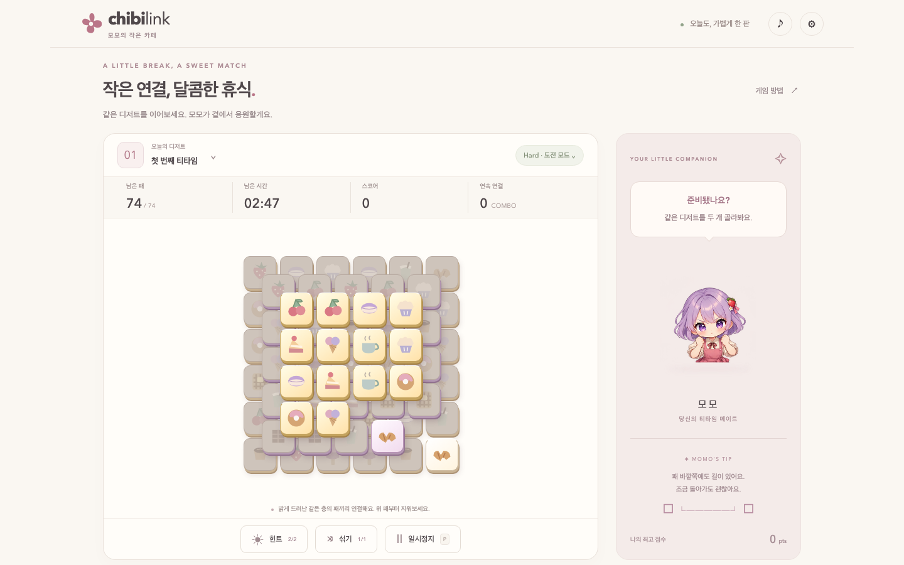
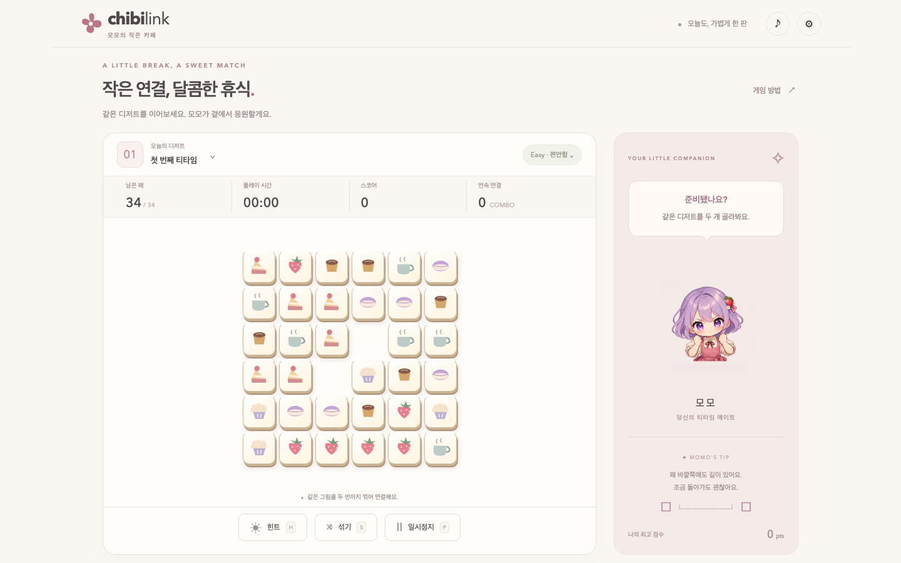
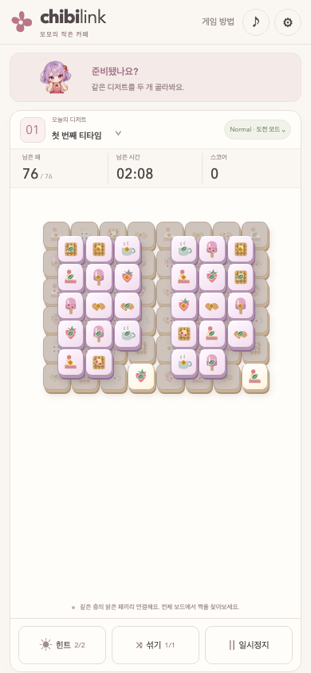

# ChibiLink — Momo's Little Café

ChibiLink is a single-player tile-matching puzzle for desktop and mobile browsers. Clear matching desserts by connecting exposed tiles with paths that bend at most twice, uncovering the layers below as you play. Momo, a chibi café companion, reacts to your matches while an original synthesized café soundtrack plays.

**[Play ChibiLink](https://hyangdan2.github.io/CDXPilot0006/)** · [Changelog](docs/CHANGELOG.md)



_Hard stacks three connected floors; shaded tiles become selectable as the tiles covering them are removed._

## Features

- **Three difficulties, ten stages each:** Easy uses a 4×6 base and one floor, Normal 6×6 and two floors, and Hard 8×6 and three floors. PC and mobile share the same logical layouts; holes and corner trims adjust occupied counts.
- **Layer-aware connections:** match exposed tiles on the same floor. Routes can use the exterior border, but occupied tiles on the same or higher floor block them.
- **Relaxed or Challenge play:** play without a deadline or earn time with each match—Easy +3 seconds, Normal +2 seconds, Hard +1.5 seconds, capped at the starting time.
- **Dessert families and combos:** 36 available SVG variants use distinct topping shapes and colors. Stages select a subset; successive matches build combos and score.
- **Recoverable puzzles:** seeded generation retains a complete solution, while hints, shuffles and limited Challenge recovery help when a chosen sequence leaves no moves.
- **A customizable companion:** nine expressions, reduced motion, character visibility and sound settings; BGM continues through in-game popups. Settings, unlocked stages and best scores save locally.

| Easy: one floor | Normal: touch layout |
| --- | --- |
|  |  |

_The whole board stays visible without dragging. Portrait and landscape layouts adapt tile size to the available screen._

## Controls

| Input | Action |
| --- | --- |
| Click or tap two tiles | Select a matching pair |
| Tab, then Enter or Space | Focus and activate tile or interface buttons |
| H / Hint button | Highlight a legal pair |
| S / Shuffle button | Rearrange surviving symbols without moving tile positions |
| P / Pause button | Pause; use the dialog to resume or restart |
| Header buttons | Open instructions/settings or toggle audio |

Keyboard shortcuts are inactive while a dialog is open. Touch play uses taps in either orientation; the board does not pan. Mobile pinch/double-tap zoom is restricted, while overflowing dialogs remain scrollable. Rotating the device or leaving the page pauses play.

Challenge allows **two hints (−8 seconds each)**, **one manual shuffle (−12 seconds)** and **one automatic deadlock recovery (−15 seconds and −150 points, with a zero score floor)**. If another deadlock occurs, use the remaining manual shuffle; a blocked board with no recovery left ends the run. Relaxed mode has unlimited assists and recovery. Match bonuses never revive an expired game.

## How to Play

1. Open settings to choose Easy, Normal or Hard and optionally enable Challenge. Normal is the default for a new player. Press **티타임 시작하기** (Start teatime).
2. Match identical exposed desserts on the same floor. The connection may turn at most twice through empty space, including outside the board. Lower floors do not block an upper-floor route.
3. Clear every tile to finish the stage and unlock the next one. Challenge also ends when time expires or no permitted recovery remains. Use the result dialog to continue/retry, or pause to restart.

Use **게임 허브로** (Game Hub) on the start card, pause menu or results to return to [GameHub](https://hyangdan2.github.io/GameHub/) in the same tab. The pause menu warns that an unfinished board is not saved.

Progress and best scores are stored per difficulty and mode in this browser. Earlier rule sets' records remain visible under settings and are separate from current scores. This saves progression, not an in-progress board; there is no account or cross-device synchronization. Storage failures do not prevent play.

## Getting Started

Requires **Node.js 22.13+ and npm**; `.nvmrc` pins **24.19.0**, the locally verified runtime. No backend service or environment secrets are required.

```bash
# With a compatible Node version active:
npm ci
npm run dev
```

Open the address Vite prints, normally **http://127.0.0.1:5173/**. Vite can choose another port if it is occupied. On the original Mac, `./scripts/dev-local.sh` can select the bundled Codex Node runtime when system Node is too old; other machines should install a compatible Node version. The launcher still requires installed dependencies.

To build and preview the production output:

```bash
npm run build
node scripts/serve.mjs
```

The build writes `dist/`. The preview binds to localhost and serves **http://127.0.0.1:4173/CDXPilot0006/**; use that exact path, not the server root. `PORT` optionally changes the preview port. Serve the files over HTTP rather than opening `index.html` directly.

## Development

The project uses TypeScript, Vite and DOM/CSS rendering; Vitest covers pure rules and Playwright exercises the browser.

| Command | Purpose |
| --- | --- |
| `npm run verify` | Runtime check, character/branding assets, lint, types, model tests and production build |
| `npm test` | Model, generation, timer and storage regressions |
| `npm run test:e2e` | Build and test production gameplay, layouts, touch input and audio |
| `npm run lint` / `npm run typecheck` | Static code and TypeScript checks |
| `npm run assets:check` / `npm run branding:check` | Character margins and sharing/favicon metadata |
| `node scripts/verify-hosted.mjs` | Public-site layout, input and character asset acceptance |
| `node scripts/verify-hosted-hub.mjs` | Live GameHub round trips, Back/storage preservation and deployed bundle identity |
| `node scripts/verify-hosted-timing.mjs` | Public Challenge budgets and popup timer pausing |

Before E2E tests, run `npx playwright install chromium` (Linux CI uses `--with-deps`). Stop a manually running production preview first: E2E owns port 4173 and refuses to reuse an existing server. Run E2E suites one at a time. Hosted scripts write reports/screenshots into `docs/hosted-evidence`; review intended changes before committing them.

These commands are defined in the repository. The latest gameplay release passed **36 model tests and 52 browser tests in CI**, with separate public-site checks recorded in [QA](docs/QA.md); this is release evidence, not a claim that every checkout has been tested.

### Project structure

| Path | Responsibility |
| --- | --- |
| `src/model.ts` | Pure connection rules, supported boards, scoring, timers and recovery |
| `src/main.ts`, `src/style.css` | Input, dialogs, responsive presentation and composition |
| `src/storage.ts`, `src/music.ts`, `src/icons.ts` | Local records, synthesized audio and dessert artwork |
| `public/`, `art/` | Runtime assets, preserved source art and generation provenance |
| `tests/`, `scripts/` | Model/browser regression checks, asset tools and preview server |
| `docs/`, `.github/workflows/` | Design, QA evidence, maintenance and CI/Pages publishing |

Only the game model mutates puzzle state; rendering and the companion consume it. Character exports retain 106px transparent margins on 512×512 canvases plus an independent 10% runtime inset. Read [AGENTS.md](AGENTS.md), [Architecture](docs/ARCHITECTURE.md), [Harness](docs/HARNESS.md) and [Plan](PLAN.md) before changes. The development server's `/art-review.html` displays the character expressions.

## Deployment

[The GitHub Actions workflow](.github/workflows/ci.yml) verifies pushes to `main`, pull requests and manual dispatches. Successful `main` runs upload **only `dist/`** and deploy it to GitHub Pages; pull requests do not publish. QA screenshots and reports are retained as a separate workflow artifact.

The repository owner must enable Actions, choose **GitHub Actions** as the Pages source, and allow the `github-pages` environment to deploy. Deployment uses scoped `pages: write` and `id-token: write` permissions. No personal deployment token is configured.

For a fork, configure Pages on the fork and update the canonical/share URLs in `index.html`, README play links and hosted-check destinations. If renaming the project, also update the explicit `/CDXPilot0006/` preview/E2E paths and related checks. Vite assets themselves use relative URLs. See [Deployment](docs/DEPLOYMENT.md) for release and rollback procedures.

The latest gameplay release was deployed successfully in [Actions run 39335817723](https://github.com/HyangDan2/CDXPilot0006/actions/runs/39335817723), followed by public-site validation. Deployment configuration alone does not establish live-site health; repeat hosted acceptance after a release.

## Documentation and Limitations

- [Architecture and design rules](docs/ARCHITECTURE.md) · [Decisions](docs/DECISIONS.md)
- [Verification harness](docs/HARNESS.md) · [QA results and evidence](docs/QA.md)
- [Maintenance](docs/MAINTENANCE.md) · [Implementation plan](PLAN.md)
- [Character asset pipeline](docs/ART_PIPELINE.md) · [Momo generation provenance](art/PROMPTS.md)

The game has ten stages per difficulty, Korean interface text, local saves and single-player mouse/touch/keyboard input. Multiplayer, gamepad controls and cloud saves are not implemented. Generation guarantees a solution exists, not that every sequence of matches avoids a deadlock.

Chromium desktop and emulated touch layouts have been checked at six viewport sizes, including the public site. Physical iPhone/Android devices, Safari, platform zoom overrides and speaker/listening quality remain unverified. Small screens use smaller tile targets to keep the whole board visible; physical touch comfort is not certified. Audio begins after a user gesture and pauses when muted or backgrounded; cosmetic/audio failures must not block matching.

Momo is generated artwork with preserved source and documented processing. No repository license file is currently provided; asset provenance is not a license grant.
